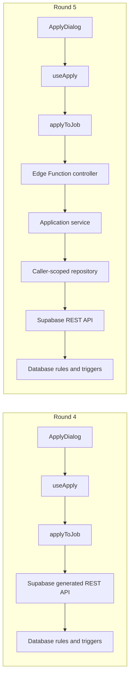

<div align="center">

<picture>
  <source media="(prefers-color-scheme: dark)" srcset=".github/assets/logo-dark.svg">
  
</picture>

<br>

**Every open role, ranked by how well it fits you.**

A two-sided job board. Seekers get a feed scored against their profile, with the reasons shown.<br>
Recruiters get a pipeline whose stages their candidates can see.

<p>
  <a href="https://jobboard-eta-two.vercel.app"><picture><source media="(prefers-color-scheme: dark)" srcset="https://img.shields.io/badge/live_demo-jobboard--eta--two.vercel.app-fad53b?style=flat-square&logo=vercel&logoColor=white&labelColor=5a544f"></picture></a>&nbsp;
  <a href="https://github.com/joshuatighe/jobboard/deployments"><picture><source media="(prefers-color-scheme: dark)" srcset="https://img.shields.io/github/deployments/joshuatighe/jobboard/Production?style=flat-square&logo=vercel&label=production&logoColor=white&labelColor=5a544f"></picture></a>&nbsp;
  <a href="https://github.com/joshuatighe/jobboard/commits/main"><picture><source media="(prefers-color-scheme: dark)" srcset="https://img.shields.io/github/last-commit/joshuatighe/jobboard/main?style=flat-square&logo=github&label=last%20commit&color=393430&logoColor=white&labelColor=5a544f"></picture></a>&nbsp;
  <a href="https://github.com/joshuatighe/jobboard/pulls?q=is%3Apr+is%3Amerged"><picture><source media="(prefers-color-scheme: dark)" srcset="https://img.shields.io/github/issues-pr-closed/joshuatighe/jobboard?style=flat-square&logo=github&label=pull%20requests&color=393430&logoColor=white&labelColor=5a544f"></picture></a>
</p>

<p>
  <a href="https://react.dev"><picture><source media="(prefers-color-scheme: dark)" srcset="https://img.shields.io/badge/React-19-393430?style=flat-square&logo=react&logoColor=white&labelColor=5a544f"></picture></a>&nbsp;
  <a href="https://www.typescriptlang.org/docs/"><picture><source media="(prefers-color-scheme: dark)" srcset="https://img.shields.io/badge/TypeScript-6-393430?style=flat-square&logo=typescript&logoColor=white&labelColor=5a544f"></picture></a>&nbsp;
  <a href="https://vite.dev/guide/"><picture><source media="(prefers-color-scheme: dark)" srcset="https://img.shields.io/badge/Vite-8-393430?style=flat-square&logo=vite&logoColor=white&labelColor=5a544f"></picture></a>&nbsp;
  <a href="https://tailwindcss.com/docs"><picture><source media="(prefers-color-scheme: dark)" srcset="https://img.shields.io/badge/Tailwind_CSS-4-393430?style=flat-square&logo=tailwindcss&logoColor=white&labelColor=5a544f"></picture></a>&nbsp;
  <a href="https://tanstack.com/query/latest/docs/framework/react/overview"><picture><source media="(prefers-color-scheme: dark)" srcset="https://img.shields.io/badge/TanStack_Query-5-393430?style=flat-square&logo=reactquery&logoColor=white&labelColor=5a544f"></picture></a>&nbsp;
  <a href="https://supabase.com/docs"><picture><source media="(prefers-color-scheme: dark)" srcset="https://img.shields.io/badge/Supabase-Postgres_%2B_RLS-393430?style=flat-square&logo=supabase&logoColor=white&labelColor=5a544f"></picture></a>&nbsp;
  <a href="https://pnpm.io/motivation"><picture><source media="(prefers-color-scheme: dark)" srcset="https://img.shields.io/badge/pnpm-10-393430?style=flat-square&logo=pnpm&logoColor=white&labelColor=5a544f"></picture></a>
</p>

<sub>[Live demo](https://jobboard-eta-two.vercel.app) · [Features](#features) · [Demo accounts](#demo-accounts) · [Getting started](#getting-started) · [Deploy](#deploy) · [Stack](#stack)</sub>

</div>

---

## HW 6 — Round 5: Refactor the application workflow

Application submission now passes through a custom server-side controller and application service, implemented as the `submit-application` Supabase Edge Function. The form and query-cache behavior remain the same. Job browsing, posting management, withdrawals, and status changes retain their existing data-access paths.

### Before and after



### Responsibility changes

| Layer | Responsibility after refactor |
| --- | --- |
| React form | Collect inputs, give immediate validation feedback, display success/errors |
| Query hook | Run the mutation and update cached application data |
| Frontend adapter | Invoke the function and translate its response for the existing UI |
| Authentication adapter | Verify the user token through Supabase Auth; create a database client carrying that user's token |
| Controller | Handle POST/OPTIONS, validate the JSON contract, and return consistent HTTP responses |
| Application service | Check seeker role, posting availability, current questions, required answers and resume; coordinate the insert |
| Repository | Perform typed database operations and translate database conflicts |
| Database | Retain RLS, column grants, unique constraints, question/resume snapshots and timeline triggers |

The caller's identity comes from the verified session, not a `seekerId` field in the request. The function does not use a secret/service-role client for submission. Request/question schemas are shared between React and the function to keep validation limits aligned.

This is a focused refactor of one complete workflow toward our intended controller-based architecture. It does not replace the entire backend or remove database safeguards. Direct inserts remain protected by the existing database rules; the app's normal submission path now uses the controller.

### Deploy and run

Apply the Round 4 migrations first. Deploy the function before using the refactored frontend:

```bash
npx pnpm@10.28.0 supabase functions deploy submit-application --project-ref YOUR_PROJECT_REF --use-api
npx pnpm@10.28.0 dev
```

Or, for the linked project, run `pnpm functions:deploy`. The configuration keeps `verify_jwt = true`; the handler also verifies the user's session. Supabase provisions the function's project URL and public API key environment. The browser continues using only `VITE_SUPABASE_URL` and its public key.

For Docker/local Supabase, `pnpm db:start` now includes the Edge Runtime. Run `pnpm functions:serve` and point the frontend at the local Supabase URL/key. Keep the existing local database/seed instructions below.

The function's import map pins the same Supabase client and Zod versions as the frontend. `pnpm typecheck` and `pnpm build` also typecheck the server modules; `pnpm test` includes controller, service, authentication and frontend-adapter tests.

### Verification and process

The refactor passed 125 tests, frontend/server TypeScript checks, production build and oxlint. Added tests cover verified identity, invalid JSON, duplicate/stale answers, required questions, resume availability, closed/missing jobs, conflicts, error responses and CORS. The adapter tests confirm the frontend calls the function and never silently falls back to direct insertion.

The function was deployed to our own Supabase project. A hosted smoke test used the demo recruiter/seeker accounts and a temporary fictional posting. It verified successful submission, question/resume snapshots, recruiter visibility, the initial timeline event, duplicate prevention, invalid-token rejection, and invalid/stale-answer rejection. Temporary records were removed after testing. The original team's project and frontend deployment were not changed.

AI tool: Codex. Prompt: refactor application submission into a server-side controller/service while retaining database safeguards and the existing user experience. Steps: share the request contract; introduce authentication, controller, service and repository modules; replace the frontend insert with a function invocation; add regression tests; deploy and verify the hosted workflow.

Reference: [Supabase Edge Function authentication](https://supabase.com/docs/guides/functions/auth).

## HW 6 — Round 4: Build the target

This local version adds the five target features below. The original live demo linked above runs the other team's version and has not been updated by this work.

| Target | Implemented behavior |
| --- | --- |
| Custom recruiter questions | Up to 10 required or optional text questions per posting. Seekers answer during application; both the recruiter and seeker can view submitted responses. Question wording is saved with the application. |
| Pay range search | Two-handle annual pay slider synchronized with minimum and maximum number inputs; matches overlapping advertised ranges. Unset bounds remain unrestricted, and the slider expands for larger typed amounts. Hourly pay is converted using 2,080 hours/year. |
| Numeric experience search | Recruiters specify minimum/maximum years independently of existing experience categories. Seekers filter by an overlapping numeric range. |
| Applicant table | A table alongside the existing board, with name, YOE, applied date, status, filters for each, candidate details, and the existing status-change actions. |
| Structured locations | Separate city and US state fields for postings, seeker profile location, and search. State selection and city format are validated; city existence is not checked against a geographic directory. |

### Run this version with your own Supabase project

The demo application accounts do **not** provide Supabase dashboard access. Use a new Supabase project, or obtain an invitation from the original project's owner. These changes have not been applied to the original hosted database.

1. Create a Supabase project with Data API enabled, automatic table exposure disabled, automatic RLS enabled, and default Postgres. Save the generated database password. Extract this source archive and open its folder in a terminal.
2. Install the prerequisites listed below, then run `pnpm install --frozen-lockfile`.
3. Copy `.env.example` to `.env.local` and enter your project's URL, anon/publishable key, and `SUPABASE_SECRET_KEY` (or legacy service-role key). Keep the secret key server-only; it is used for seeding.
4. Run `pnpm supabase login`, then `pnpm supabase link --project-ref YOUR_PROJECT_REF`.
5. Run `pnpm supabase db push`. For a new project this applies all migrations, including `20261013000000_round4_target_functionality.sql`. For an existing project it applies pending migrations. Review the project selection before pushing.
6. Run `pnpm db:seed --dry-run` to preview counts, then `pnpm db:seed` to create the demo accounts, jobs, sample questions, resumes, and applications.
7. For the current Round 5 version, deploy `submit-application` as described above, then run `pnpm dev` and open `http://localhost:5173`.

The documented Docker/local Supabase setup below is also supported. Apply migrations **before** running this frontend: the new code expects the added columns. Regenerate database types using `pnpm db:types` after applying migrations when further schema changes are made.

### Demo workflow

1. Sign in as `recruiter@jobboard.dev` with password `jobboard-demo` on **your running version**.
2. Create or edit a posting. Enter city/state, pay and numeric experience bounds; add one required and one optional question; publish.
3. In a separate browser profile/private window, sign in as `seeker@jobboard.dev` with password `jobboard-demo`.
4. Search using both pay bounds, numeric experience bounds, city and state. Open the posting, use/upload a PDF resume, answer the questions, and apply.
5. Return to the recruiter window. Open that posting's Applicant table, filter by name/YOE/date/status, select the candidate, review answers, and change status.
6. Refresh the seeker's application tracker to see the status and saved responses.

### Data and behavior decisions

- The migration backfills recognizable existing `City, ST` values. Other legacy labels are preserved. Fully remote postings may omit both city and state. This version's structured form targets US locations.
- Existing jobs are not assigned invented numeric experience requirements. When a numeric search is active, jobs with both bounds unspecified are excluded. The seed script assigns explicit illustrative numeric ranges to demo jobs.
- Applicant YOE comes from the union of work-history months through the current month, avoiding double-counting overlapping jobs. It is live profile information, not a value snapshotted at submission. Date filters use the browser's local time zone.
- Submitted question responses are immutable to application users. Database validation rejects missing required answers, duplicate/missing IDs, overlong answers, and stale question wording. Editing a posting does not rewrite old applications.
- Preference-location tags and work-history location notes remain as existing descriptive fields; the main posting/profile/search locations use structured fields.

### Verification performed

- TypeScript checks and production build passed.
- 105 Vitest tests passed, including 11 added tests covering questions, numeric bounds, location validation, composed search filters, and applicant filtering/experience calculations.
- oxlint and `git diff --check` passed.
- All migrations applied successfully to an isolated PostgreSQL database with minimal Supabase Auth/Storage stubs, both with and without automatic table privileges. `scripts/tests/round4-database.sql` passed as authenticated seeker and recruiter roles, checking validation, snapshot preservation, status history, and cross-company isolation. This does not verify the managed Supabase Auth/Storage services themselves.
- Browser checks used test-only Supabase responses to verify posting creation, question validation/submission, pay/experience/city/state filter composition, table filtering, candidate answers, status changes, and profile location saving. Desktop and mobile screenshots were inspected. A real Supabase end-to-end run remains to be done after a project is configured.

### Round 4 process and architecture effects

AI tool: Codex. The user asked to implement custom recruiter questions, pay range filtering, numeric years-of-experience filtering, an applicant table with field filters, and structured city/state entry.

Steps: inspect the existing code; extend the schema and types; update posting/application/search/profile forms and data access; add the applicant table; add domain and database tests; fix issues identified by those tests and browser review; document setup and package the source.

The existing React → query hooks → data-access functions → Supabase path remains. Feature development adds JSONB question/answer snapshots, structured location columns, numeric experience columns, new validation/normalization triggers, and an applicant query that includes work-history dates. Rules continue to be distributed between frontend validation and database enforcement. This records the structural changes resulting from Round 4; it does not introduce the controller/service-layer refactor proposed for Round 5.

## Features

### For job seekers
- **For You feed.** Every open job is scored 0–100 against your level, locations, minimum pay, job types and skills.
  Each match shows its score and one chip per criterion it meets.
- **Search and filters.** Keyword search with filters for pay, location / remote and experience level. Filters live in
  the URL, so a search can be shared and survives back / forward.
- **One profile.** Headline, bio, skills, work history, preferences and a PDF resume. Each section saves on its own.
- **Apply in seconds.** The resume on file is attached and snapshotted with the application. Add a cover note if you
  want. If there's no resume yet, you can upload one in the apply dialog.
- **Application tracker.** Every application's status, a progress bar, the full timeline, the resume you sent, and
  withdrawal (including declining an offer).

### For recruiters
- **Postings dashboard.** Open, draft and closed roles with applicant counts by stage.
- **Posting editor.** Pay range, location / remote, level, type, skills and a description with a live preview. Save as
  a draft or publish; close and reopen later.
- **Applicants pipeline.** A board with columns for New, In review, Interviewing, Offer and Closed. Open a candidate to
  read their resume, cover note and work history, then move them to any stage. The seeker's tracker shows the change.

### Everywhere
- Light and dark mode, responsive down to 375px, keyboard navigable.
- Access is enforced by Postgres Row Level Security, not the UI. Resumes sit in a private bucket and are opened through
  signed URLs.

## Demo accounts

`pnpm db:seed` creates 24 companies, 160 jobs, 80 seekers, 24 recruiters, 133 work-history entries,
80 fictional testing resumes, 480 applications and 1,272 timeline events on a fresh project.
The main Lumen AI Frontend Engineer posting has 60 applicants. These expanded counts describe this local
seeder; the [original live demo](https://jobboard-eta-two.vercel.app) may use an older dataset.
Rerunning refreshes demo jobs and profiles while preserving existing applications and timelines.

| Role | Email | Password |
| --- | --- | --- |
| Job seeker (Jordan Rivera) | `seeker@jobboard.dev` | `jobboard-demo` |
| Recruiter (Morgan Lee, Lumen AI) | `recruiter@jobboard.dev` | `jobboard-demo` |

> [!TIP]
> To be signed in as both at once, use two browser windows that don't share storage (a normal and a private window,
> or two browser profiles). Tabs in the same window share one session.

## Getting started

### 1. Prerequisites
- Node.js 20.19+ or 22.12+, and [pnpm](https://pnpm.io) 10 (`corepack enable` picks up the pinned version)
- A free [Supabase](https://supabase.com) project, or Docker to run Supabase locally

### 2. Install

```bash
git clone https://github.com/joshuatighe/jobboard.git
cd jobboard
pnpm install
cp .env.example .env.local   # then fill in your Supabase keys
```

### 3. Set up the database

```bash
pnpm supabase link --project-ref <your-project-ref>
pnpm supabase db push     # schema, triggers, RLS policies, storage bucket
pnpm db:seed              # demo companies, jobs, users and applications
```

> [!TIP]
> For instant sign-ups, turn off **Authentication → Sign In / Providers → Email → Confirm email** in Supabase.

<details>
<summary><strong>Or run Supabase locally</strong></summary>

<br>

With Docker running, you can skip the hosted project entirely:

```bash
pnpm db:start                         # Postgres, Auth, REST and Storage in Docker; applies migrations
pnpm supabase status -o env           # copy API_URL / ANON_KEY into .env.local as VITE_SUPABASE_URL / VITE_SUPABASE_ANON_KEY
SUPABASE_SERVICE_ROLE_KEY=<SERVICE_ROLE_KEY> pnpm db:seed
```

</details>

### 4. Run

```bash
pnpm dev
```

Open [localhost:5173](http://localhost:5173) and sign in with a [demo account](#demo-accounts).

## Environment

| Variable | Used by | Description |
| --- | --- | --- |
| `VITE_SUPABASE_URL` | App | Project URL, bare (`https://<ref>.supabase.co`) |
| `VITE_SUPABASE_ANON_KEY` | App | Public anon key. Safe in the browser because RLS enforces access |
| `SUPABASE_SECRET_KEY` | `pnpm db:seed` | Server-only secret key for seeding. **Never** prefix with `VITE_` or set it in Vercel |
| `SUPABASE_SERVICE_ROLE_KEY` | `pnpm db:seed` | Legacy alternative for seeding. **Never** prefix with `VITE_` or set it in Vercel |
| `SUPABASE_PROJECT_REF` | `pnpm db:types` | Bare project ref, not a dashboard URL |
| `SUPABASE_ACCESS_TOKEN` | Supabase CLI | Personal access token for `link` / `db push` |
| `SUPABASE_DB_PASSWORD` | Supabase CLI | Database password for `db push` |

`.env.example` lists them all with placeholders. `.env.local` is gitignored.

## Scripts

| Command | What it does |
| --- | --- |
| `pnpm dev` | Start the dev server |
| `pnpm build` | Typecheck and build for production |
| `pnpm preview` | Serve the production build |
| `pnpm lint` | Lint with oxlint |
| `pnpm typecheck` | Typecheck frontend and server modules |
| `pnpm functions:serve` / `functions:deploy` | Serve the application controller locally / deploy it to the linked project |
| `pnpm test` / `test:watch` | Run the Vitest unit tests (once / watch) |
| `pnpm db:start` / `db:stop` | Start or stop local Supabase (Docker) |
| `pnpm db:reset` | Wipe the local database and re-apply migrations |
| `pnpm db:seed` / `db:seed:local` | Seed demo data (hosted / local) |
| `pnpm db:types` / `db:types:local` | Regenerate `src/types/database.ts` (hosted / local) |

## Deploy

1. Import the repo into [Vercel](https://vercel.com/new). The framework preset is **Vite**, and pnpm is detected from
   `pnpm-lock.yaml`.
2. Add `VITE_SUPABASE_URL` and `VITE_SUPABASE_ANON_KEY` as environment variables.
3. In Supabase → **Authentication → URL Configuration**, set your Vercel domain as the Site URL.
4. Deploy. `vercel.json` rewrites every route to `index.html` for client-side routing.

## Stack

| | |
| --- | --- |
| **Frontend** | Vite · React · TypeScript (strict) · Tailwind CSS v4 · shadcn/ui (Radix) · IBM Carbon icons |
| **Type** | Newsreader · Instrument Sans · Geist Mono |
| **Data** | TanStack Query · react-hook-form · zod |
| **Backend** | Supabase: Postgres, Auth, Storage, Row Level Security |
| **Tooling** | pnpm · Supabase CLI · oxlint · Vitest |
| **Hosting** | Vercel |

## Project structure

```
src/
  routes/          pages: marketing, auth, seeker, recruiter
  components/      ui (shadcn), layout, and feature components
  lib/
    api/           typed Supabase data access
    queries/       TanStack Query hooks over lib/api
    *.ts           pure, unit-tested logic: matching, feed, pipeline, postings, tracker
supabase/
  functions/       application controller, service, repository, and shared contract
  migrations/      schema, triggers, RLS, storage bucket
scripts/           idempotent seed script and demo data
```

See [`CLAUDE.md`](./CLAUDE.md) for the full requirements, data model, design language and decisions.

---

<div align="center">
<sub>Built for a software engineering course · Requirements by our client team · 2026</sub>
</div>
